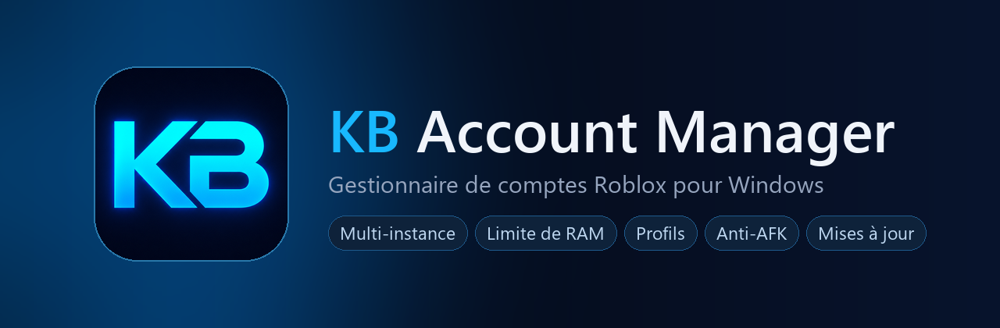
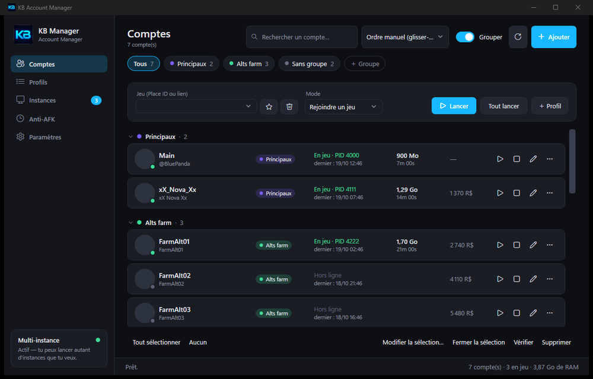
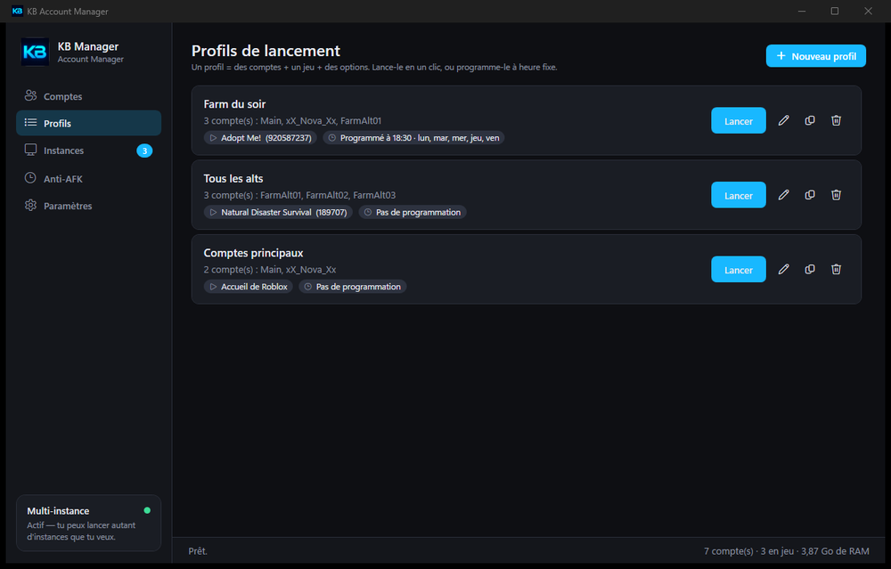
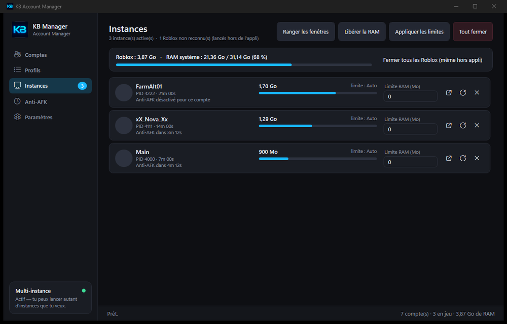
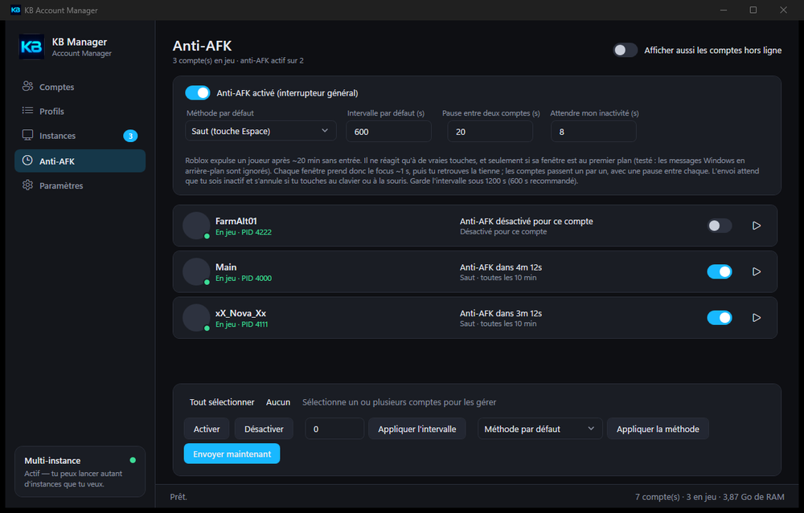

  

  
  
  
  
  

  

Installateur de 2 Mo · installation pour ton compte Windows seul, sans droits administrateur

---

## Aperçu

  
  

  
  

## Ce que ça fait

**Comptes et lancement**
- Ajoute tes comptes par cookie, en import de masse, ou en te connectant dans un navigateur intégré.
- Lance **autant de fenêtres Roblox que tu veux** en même temps, une par compte, avec un délai réglable entre chaque.
- **Groupes** colorés, recherche, tri, glisser-déposer, et **actions groupées** (alias numérotés, jeu par défaut, RAM, relance auto…).
- **Profils de lancement** : des comptes + un jeu + des options, lancés en un clic ou **programmés** à heure fixe.
- Rejoins un jeu, un serveur précis, un serveur privé, un ami, ou simplement l'accueil de Roblox.

**Performances**
- **Limite de RAM par fenêtre**, appliquée en continu, avec la mémoire de chaque instance affichée en direct.
- Priorité CPU, cœurs dédiés, **déblocage des FPS**, mode fenêtré, graphismes minimum.
- **Rangement des fenêtres** en grille sur l'écran de ton choix.

**Confort**
- **Anti-AFK** (saut ou touche discrète) qui passe d'un compte à l'autre, attend que tu sois inactif et s'annule si tu touches au clavier.
- **Reprise des instances** : tu fermes ou redémarres l'appli, tes Roblox restent ouverts et sont reconnus au retour.
- Icône dans la **barre système**, démarrage avec Windows, relance automatique d'un compte qui se ferme.
- **Mises à jour automatiques** : une carte apparaît dans l'appli quand une nouvelle version sort.

**Sécurité**
- Cookies **chiffrés** sur ton disque, mot de passe optionnel (AES-256), verrouillage automatique, « J'ai oublié mon mot de passe » qui réinitialise tout.
- Les cookies ne sont envoyés qu'à roblox.com, en HTTPS. Le client Roblox n'est lancé que s'il est signé par Roblox Corporation.
- Mises à jour **signées** : l'appli refuse tout fichier qui n'a pas la signature du développeur.

## Installation

1. **[Télécharge `KB-Account-Manager-Setup.exe`](https://github.com/beelugaa/kb-account-manager/releases/latest/download/KB-Account-Manager-Setup.exe)** et lance-le.
2. Windows peut afficher un écran bleu « SmartScreen » car l'installateur n'est pas signé par un éditeur payant : clique sur **Informations complémentaires**, puis **Exécuter quand même**.
3. Choisis tes options (raccourcis, démarrage avec Windows) puis **Installer**.

Prérequis : Windows 10 ou 11 et le [runtime .NET 8 Desktop](https://dotnet.microsoft.com/download/dotnet/8.0) (Windows te propose de l'installer s'il manque).
Pour désinstaller : *Paramètres Windows › Applications › Applications installées › KB Account Manager*.

> **Important** — Ferme tous tes Roblox **avant** d'ouvrir KB Account Manager la première fois : le multi-instance doit prendre la main avant le client.

## Mises à jour

L'appli cherche toute seule les nouvelles versions. Quand il y en a une, une carte **Mise à jour disponible** apparaît dans la barre latérale (et une bulle dans la barre système) : un clic, et elle s'installe puis se rouvre. Tes comptes et réglages sont conservés, et tes Roblox ouverts ne sont pas fermés.

## Questions fréquentes

<b>Mes cookies sont-ils envoyés quelque part ?</b>

Non. Ils restent chiffrés sur ton PC et ne sont utilisés que pour parler à roblox.com. Le code source est publié dans ce dépôt pour que tu puisses le vérifier toi-même (voir [`RobloxApi.cs`](BBManager/Services/RobloxApi.cs) et [`DataStore.cs`](BBManager/Services/DataStore.cs)).

<b>L'anti-AFK prend-il le focus de ma fenêtre ?</b>

Roblox ignore les touches envoyées à une fenêtre en arrière-plan, donc chaque fenêtre doit passer au premier plan environ une seconde, puis tu retrouves la tienne. L'appli n'agit que lorsque tu es inactif et s'annule si tu touches au clavier ou à la souris. Les comptes passent un par un, avec une pause entre chaque.

<b>« Roblox est déjà ouvert » : le multi-instance est bloqué</b>

Un Roblox lancé hors de l'appli tient le verrou. Ferme-le : le multi-instance s'active tout seul quelques secondes plus tard. Une carte en bas à gauche de l'appli explique ce qui bloque.

<b>J'ai oublié mon mot de passe</b>

Il ne peut pas être récupéré : il sert de clé pour chiffrer tes cookies. Au démarrage, clique sur **J'ai oublié mon mot de passe** puis **Réinitialiser l'appli** : tout ce qui est enregistré est supprimé (tes comptes Roblox ne sont pas touchés) et tu peux repartir de zéro.

<b>Windows affiche « SmartScreen a empêché le démarrage »</b>

C'est normal pour un programme qui n'est pas signé par un éditeur payant. Clique sur **Informations complémentaires**, puis **Exécuter quand même**. Les mises à jour, elles, sont vérifiées cryptographiquement par l'appli.

<b>Un problème, une idée ?</b>

Ajoute-moi sur Discord : **`beluga.__`**. Décris ce que tu as vu, avec une capture d'écran si possible, et ne partage jamais ton cookie ni ton mot de passe.

## Code source

Le code est public pour être **lisible et vérifiable**, pas pour être réutilisé (voir [LICENSE](LICENSE)).

| Dossier | Contenu |
|---|---|
| [`BBManager/`](BBManager) | L'application (C#, WPF, .NET 8) : comptes, lancement, RAM, anti-AFK, sécurité, mises à jour |
| [`KB-Installer/`](KB-Installer) | L'installateur et les scripts de publication signée |

La clé privée qui signe les mises à jour n'est évidemment pas dans ce dépôt : seule la clé publique est dans l'appli, ce qui empêche quiconque d'envoyer une fausse mise à jour.

---

Outil indépendant, sans lien avec Roblox Corporation. Il lance le client officiel, lit son journal et envoie des touches ; il n'injecte rien dans le jeu. Roblox peut modifier son client ou ses règles à tout moment : utilise-le avec tes propres comptes et à tes risques.
